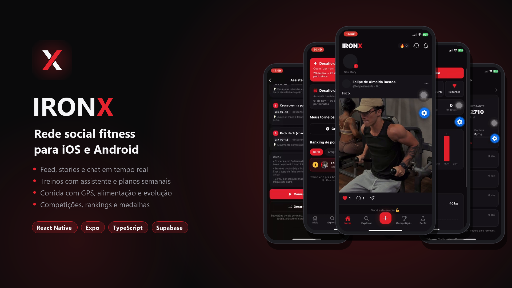

## Olá, eu sou o Felipe 👋

**Desenvolvedor de Automações** na L.A. Taunay Advogados Associados e estudante de Análise e Desenvolvimento de Sistemas.

Comecei na área financeira — faturamento, conciliação bancária e notas fiscais — e passei a automatizar essas rotinas. Hoje crio soluções que eliminam trabalho manual e repetitivo, e também desenvolvo aplicativos mobile e web.

- 🤖 Automação de processos com **Python** e **Google Apps Script**
- 🔗 Integração entre sistemas, planilhas e e-mail
- 📱 Apps mobile com **React Native**, **Expo**, **TypeScript** e **Supabase**
- 💻 Aplicações web e SaaS com **JavaScript**, **Supabase** e **Stripe**
- 📊 Excel avançado, dashboards e análise de dados

---

### 🚀 Projetos em destaque

#### IronX

**IronX** é uma rede social fitness completa para iOS e Android: feed com fotos e vídeos, stories, chat em tempo real, comunidades, registro de treinos com assistente e planos semanais, recordes pessoais, corrida com GPS, diário alimentar, evolução física e competições com rankings e medalhas.

Feito com React Native, Expo, TypeScript e Supabase (PostgreSQL com Row Level Security). *O código deste projeto é privado.*

#### Ramo

**Ramo** é um SaaS de finanças pessoais completo. Ele abre o mês com um resumo em uma frase e um gráfico de saldo projetado, que mostra como o mês vai fechar depois de pagas as contas pendentes. Tem receitas e despesas por categoria, contas a pagar com recorrência, calendário interativo, carteira de investimentos e importação e exportação de planilhas do Excel. Para virar negócio, tem contas de usuário, teste grátis e assinaturas mensais e anuais pelo Stripe, com o acesso controlado no próprio banco de dados.

Feito com JavaScript, Supabase (PostgreSQL com Row Level Security, Auth e Edge Functions em TypeScript) e Stripe. *O código deste projeto é privado.*

🏷️ **À venda no SideProjectors:** [ver anúncio do Ramo](https://www.sideprojectors.com/project/113861/ramo-personal-finance-saas-brazil)

---

### 🛠️ Tecnologias

---

### 📫 Contato

